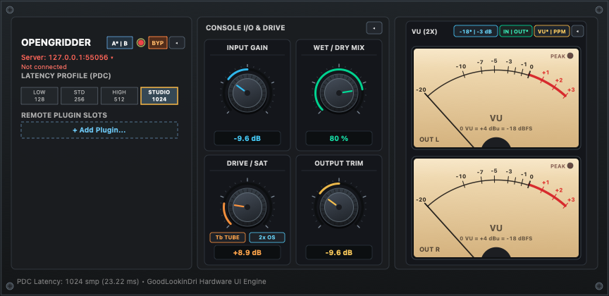

# OpenGridder

OpenGridder offloads audio plug-ins to another Mac on the network and carries
their audio and editors back into the DAW. The current pre-release is
**0.1.1-alpha**.

Server, plug-in formats and the legacy RTAS/TDM bundles are stamped with the
same product version and build number so a release is identifiable across every
format.

## Screenshots

The AU, VST3, AAX and CLAP plug-ins share one editor: console input, wet/dry,
drive and output controls, remote plug-in slots, and VU meters.



## Crates

| Crate | Role |
| --- | --- |
| `og-plugin` | Plug-in instance: gains, drive, wet/dry, bypass, latency profiles, state, editor model |
| `og-protocol` | Wire protocol v13 as explicit little-endian bytes |
| `og-server` | Plugin host, network server, isolated chains and AU/VST3 hosting |
| `og-formats` | AU, VST3, AAX, CLAP and LV2 entry points |
| `og-tray` | Menu bar companion for the server |
| `og-legacy` | TDM transport contract (Q1.23 PCM, timeslots, schedule). Not a `.dpm`; no Avid SDK |

```sh
cargo test --workspace
cargo build --release -p og-server -p og-formats -p og-tray
```

`og-server` does not depend on the Avid SDK and does not link `og-legacy`.

## Bundles and release scripts

```sh
bash scripts/build-all-bundles.sh       # AU, VST3, AAX, CLAP, LV2, Server.app
bash scripts/package-release-macos.sh   # signed installer, manifest, notices
```

AAX is 64-bit only. No 32-bit AAX is built for Pro Tools 10; Pro Tools 10 uses
the RTAS beta described below. AAX, AU and VST3
loading in real hosts is still being qualified; this is a BETA.

## Legacy RTAS/TDM

Pro Tools 10 (32-bit) is supported through the RTAS beta, a freeware binary
distributed separately.

The RTAS and TDM plug-ins are not built from this repository. They live in the
private, closed-source integration layer
`MistaMin/OpenGridder-Legacy-Wrappers`, because they compile against the
licensed Avid SDK. The compiled RTAS/TDM bundles are freeware, not open source;
their source is not published. No Avid SDK source, headers or tools are in this
repository. The compiled AAX plug-in links the AAX SDK runtime under Avid's
licence; the RTAS/TDM bundles do the same with the separately licensed RTAS/TDM
SDK in the private repository. See [LEGACY.md](LEGACY.md).

The private wrappers tree also contains the ppc/i386 OS X 10.5.8 Leopard build,
the DSP56321 firmware and its differential emulator checks. Those builds use
the same `OG_VERSION`, `OG_BUILD_NUMBER`, `OG_GIT_COMMIT` and `OG_BUILD_DATE`
values as this project so every format shows one release identity.

## Status

- BETA, not qualified by Avid or by any DAW vendor.
- Pro Tools AAX loading, PowerPC/Leopard execution and HD Accel DMA/timing are
  not yet verified on hardware.
- No 32-bit AAX; no RTAS/TDM source in this repository.
- Protocol v13 has no authentication. Use it on a trusted studio LAN only.

## Licensing

OpenGridder source in this repository is MIT-licensed (see `LICENSE` and
`COPYING`) unless a file says otherwise. Externally supplied SDKs keep their own
licences. RTAS/TDM binaries are freeware and their adapter source is private and
proprietary; see [LEGACY.md](LEGACY.md) and
[THIRD_PARTY_LICENSES.md](THIRD_PARTY_LICENSES.md).

Avid, Pro Tools, AAX, RTAS, TDM and HD Accel are trademarks of Avid Technology,
Inc. This project is not affiliated with or endorsed by Avid.
